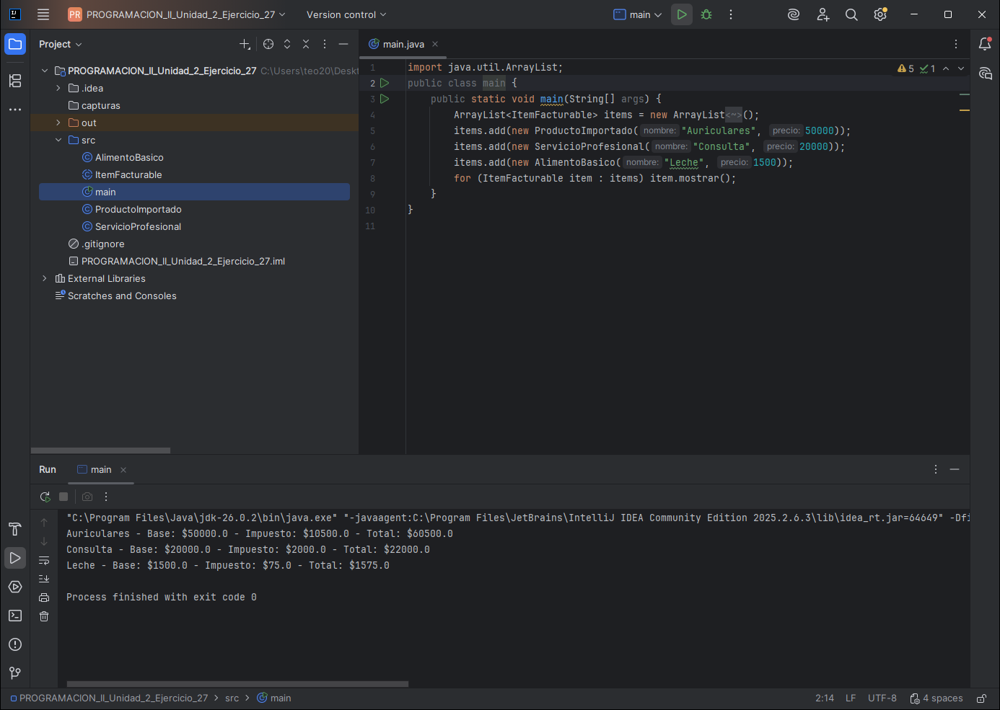

# PROGRAMACIÓN II — Unidad 2, Ejercicio 27: Cálculo de Impuestos para Productos y Servicios

Trabajo práctico de Programación II. Este repositorio contiene la resolución en Java del ejercicio 27 de la Unidad 2.

## Consigna

#### Contexto

Un sistema de facturación internacional debe calcular los impuestos aplicables según la categoría del ítem (productos electrónicos, servicios profesionales, bienes de primera necesidad). Aplicar abstracción y modularidad permite encapsular las fórmulas fiscales particulares en componentes independientes.

#### Consigna

Diseñar un sistema modular en Java que calcule el costo total de diferentes ítems comerciales aplicando reglas impositivas abstractas y polimórficas.

#### Desarrollo requerido

- Crear una clase abstracta ItemFacturable con atributos básicos (nombre, precioBase) y un método abstracto double calcularImpuesto().
- Desarrollar clases concretas hijas como ProductoImportado, ServicioProfesional y AlimentoBasico que implementen el cálculo impositivo con sus respectivas tasas.
- Agregar un método en la clase abstracta o clases hijas que devuelva el precio final (precioBase + calcularImpuesto()).
- En el método main, crear una lista de ítems facturables de distinta naturaleza, recorrerlos modularmente y mostrar el desglose de precios por consola.

## Estructura del repositorio

```
PROGRAMACION_II_Unidad_2_Ejercicio_27/
├── README.md
├── capturas/
│   └── consola.png
└── src/
    ├── AlimentoBasico.java
    ├── ItemFacturable.java
    ├── main.java   # clase con el método main
    ├── ProductoImportado.java
    └── ServicioProfesional.java
```

## Funcionamiento y lógica

El ejercicio usa una **clase abstracta** para facturar productos y servicios que pagan impuestos distintos.

### `ItemFacturable` (clase abstracta)

Tiene `nombre` y `precioBase` (`protected`), y:

- **`calcularImpuesto()`:** método **abstracto**; cada tipo de ítem define su porcentaje.
- **`calcularPrecioFinal()`:** suma el precio base y el impuesto. Es igual para todos los ítems, pero usa el impuesto de cada uno.
- **`mostrar()`:** imprime nombre, base, impuesto y total.

### Clases concretas

Heredan de `ItemFacturable` y solo cambian el porcentaje del impuesto:

- **`ProductoImportado`:** 21 %.
- **`ServicioProfesional`:** 10 %.
- **`AlimentoBasico`:** 5 %.

### `main`

Crea una lista con unos auriculares importados ($50000), una consulta profesional ($20000) y leche ($1500), y muestra cada uno:

| Ítem | Base | Impuesto | Total |
|---|---|---|---|
| Auriculares | $50000 | $10500 | $60500 |
| Consulta | $20000 | $2000 | $22000 |
| Leche | $1500 | $75 | $1575 |

## Ejecución

Captura de la consola de IntelliJ IDEA ejecutando el programa:



Salida obtenida:

```
Auriculares - Base: $50000.0 - Impuesto: $10500.0 - Total: $60500.0
Consulta - Base: $20000.0 - Impuesto: $2000.0 - Total: $22000.0
Leche - Base: $1500.0 - Impuesto: $75.0 - Total: $1575.0
```
